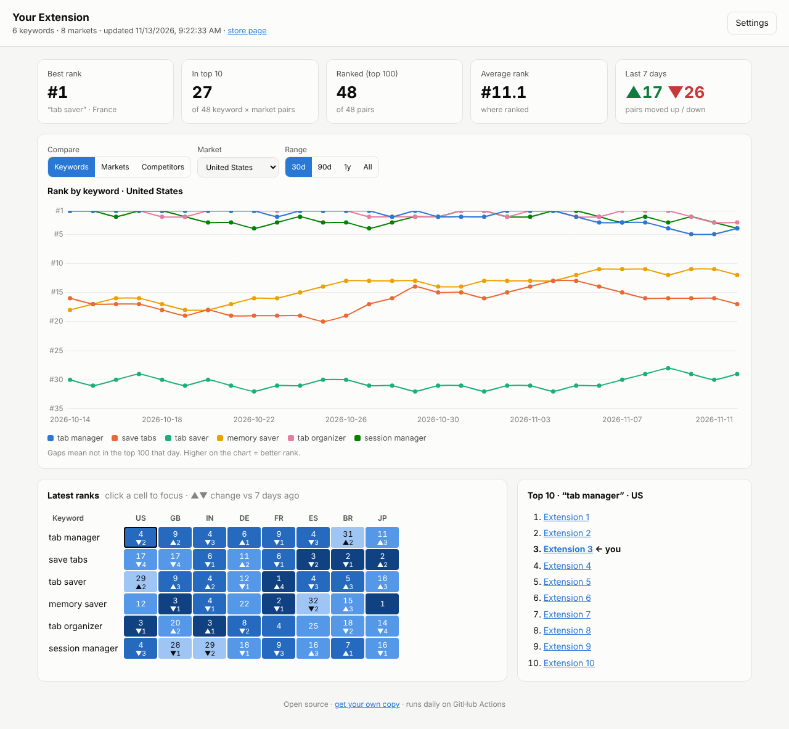

# Chrome Web Store Rank Tracker

Track where your Chrome extension ranks in Chrome Web Store search: for every keyword, in every market, every day. You get a dashboard with trend lines, a keyword × market heatmap, and a comparison against competitors.

It's free and open source, and there's no server to run. GitHub Actions does the daily search and GitHub Pages hosts the dashboard.



## What you get

- **Daily rankings** for each keyword in up to 48 markets, each searched in that market's language and region.
- **Trend charts** that compare your rank across keywords, across markets, or against competitors.
- **A heatmap** of your latest rank for every keyword × market pair, with the change over 7 days.
- **The top 10** for any search, so you can see who ranks above you.
- **In-browser settings**: paste your store link, add keywords and choose markets. No code to edit.
- **Several extensions in one dashboard.** Switch between them from the menu at the top. If two extensions track the same keyword in the same market, that search runs only once.
- **JSON exports** of keyword rankings and the competitor set, ready to give to Claude or any other analysis tool.

## Setup (about 5 minutes)

1. **Get your own copy.** Click **Use this template → Create a new repository**, or fork this repo. Keep it public: public repos get unlimited free Actions minutes.
2. **Turn on the dashboard.** In your copy, go to **Settings → Pages**. Under *Build and deployment*, set **Source: Deploy from a branch**, then **Branch: `main`** and **folder: `/docs`**, and save. Your dashboard will be at `https://<your-username>.github.io/<repo-name>/`.
3. **Allow the daily job to save data.** Go to **Settings → Actions → General → Workflow permissions**, select **Read and write permissions**, and save.
4. **Create an access token** so the dashboard can save your settings. Create a [fine-grained personal access token](https://github.com/settings/personal-access-tokens/new) with:
   - Repository access: **Only select repositories →** your copy
   - Permissions: **Contents: Read and write** and **Actions: Read and write**
5. **Open your dashboard → Settings.** Paste your extension's store link, add keywords, pick markets (or **Select all**), and paste the token under *GitHub access*. Click **Save & start tracking**.

The first run starts as soon as you save and takes a few minutes. After that it runs every day at 04:17 UTC.

> Prefer not to use a token? Edit `docs/config.json` directly on GitHub. Saving that file also starts a run.

## Who can see and change what

- The dashboard and data are public, the same as the Chrome Web Store results they come from.
- Only people with write access to your repo can change settings. The token you paste is stored in your browser and sent only to `api.github.com`.
- If you want the dashboard to be private, make the repo private. GitHub Pages for private repos needs a paid plan, and private repos get 2,000 free Actions minutes a month.

## Configuration

`docs/config.json` lists one entry per extension you track:

```json
{
  "projects": [
    {
      "extension": "https://chromewebstore.google.com/detail/your-extension/abcdefghijklmnopabcdefghijklmnop",
      "keywords": ["tab manager", "save tabs"],
      "markets": ["US", "GB", "DE"],
      "competitors": [],
      "depth": 100
    }
  ]
}
```

The original single-extension format (the same fields without the `projects` wrapper) still works.

| Field | Meaning |
|---|---|
| `extension` | Store link or 32-letter ID of the extension to track |
| `keywords` | Search terms to check |
| `markets` | Country codes from [`docs/markets.json`](docs/markets.json), or `"all"` |
| `competitors` | Other extensions (links or IDs) to track on the same searches |
| `depth` | How many results to scan per search (10–300). If you're not in that many, you're recorded as "not ranked". |

**Runtime:** each unique keyword × market search takes about 5–8 seconds, and 4 run in parallel. For example, 20 keywords × 48 markets is about 960 searches, or roughly 30 minutes a day.

## Exporting data

The **Export for analysis** section of the dashboard downloads JSON for the extension you're viewing:

- **Keyword rankings:** each keyword × market pair with its latest rank, change over 7 and 30 days, best rank, and full daily history.
- **Competitor set:**
  - the extensions that appear most often in the top 20 results for your keywords
  - a head-to-head table of your rank against each tracked competitor
  - your competitors' daily rank histories
  - the latest top 20 for every search
- **Everything:** both files in one.

Each file starts with an `about` field explaining what the fields mean, so you can hand it straight to Claude with a question such as *"Which keywords and markets should I focus on, and who is beating me there?"*

## How it works

1. `.github/workflows/track.yml` runs daily, whenever `docs/config.json` changes, and when you click **Run now**.
2. `scripts/track.mjs` opens `chromewebstore.google.com/search/<keyword>?hl=<lang>&gl=<country>` in headless Chromium. It loads results until it reaches `depth`, and records each tracked extension's position.
3. Results are committed to `docs/data/`:
   - `projects/<extension-id>.json`: daily rank series for each extension
   - `latest.json`: today's top results
   - `status.json`: run health
   - `extensions.json`: names and icons
4. `docs/index.html` is a static dashboard that reads those files.

To run it locally:

```bash
npm ci && npx playwright install chromium
node scripts/track.mjs
npx serve docs   # open the dashboard
```

## Notes and limits

- **Rankings aren't official.** They're what an anonymous visitor would see from a GitHub (US-based) server, using the market's language and region parameters. Personalized results may differ slightly.
- **The scraper may need occasional fixes.** The Web Store sometimes changes its page layout. If runs start failing, the dashboard shows a warning; please open an issue or PR.
- **Use it reasonably.** The tracker searches slowly and politely. Don't crank concurrency up.
- **Scheduled runs pause after 60 days without commits.** GitHub disables scheduled workflows in repos with no activity for 60 days. The daily data commits keep it active, but if runs ever stop, re-enable the workflow in the **Actions** tab.

## License

MIT
